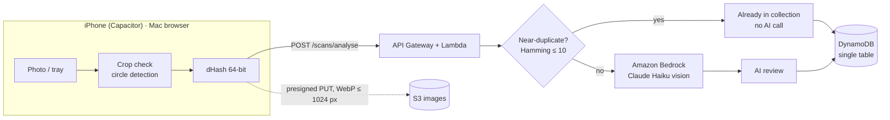

<div align="center">


# CapCollector

**Catalogue a bottle-cap collection with your iPhone: shoot, let AI fill in the details, find where each cap sits
in your album.**

[](https://github.com/eiglesia4/Cap-Collector/actions/workflows/ci.yml)
[](TEST.md)
[](LICENSE)


</div>

> [!IMPORTANT]
> **A personal app, not a service.** CapCollector is built for **one collector** (or a handful of people you allow)
> running **their own copy**: there is no shared server, no sign-up and no App Store listing.
>
> - **iOS first.** The phone app is an iPhone app (Capacitor). The same build runs in a browser on the Mac for
>   browsing and editing; on the web, "Scan" becomes "Upload photo".
> - **Requires your own AWS account.** Everything runs serverless in your account (≈ 2–5 €/month for a personal
>   collection), and you deploy it yourself with AWS CDK.
> - **Requires an Apple Developer account** to install it on your iPhone and for Sign in with Apple.

## What it does

|                              |                                                                                                                                                                                                                              |
| ---------------------------- | ---------------------------------------------------------------------------------------------------------------------------------------------------------------------------------------------------------------------------- |
| 📷 **AI-assisted capture**   | Shoot a cap (or a whole tray of them). A vision model (Claude Haiku on Amazon Bedrock) proposes brand, variant, producer, country, type, year and a description, with a confidence per field. Unsure fields are highlighted. |
| ♻️ **Duplicates before AI**  | A 64-bit perceptual hash (dHash) of every photo is compared with your collection **before** any AI call. A cap you already have lands in "Already in collection" and costs nothing.                                          |
| ✅ **Nothing saved blindly** | Every capture ends in one of three review screens (AI review · Already in collection · Manual entry). Guesses and defaults are marked "to verify" until you check them. Every change keeps a history; deletes are soft.      |
| 🗂️ **Batch mode**            | Lay 15–30 caps on a dark cloth, take one photo: the caps are detected **on the phone**, you fix the circles, then review them one by one ("4 of 11"), with resume if you close the app.                                      |
| 📒 **Physical album link**   | Model your binders (album · sheet · pocket, e.g. `A·3·17`), see each sheet as a grid, move and swap caps, and let **Plan layout** place hundreds of unplaced caps by type → country → brand.                                 |
| 🖨️ **Printable inserts**     | A4 PDF with a numbered disc for every pocket (code, brand, QR back to the cap) plus a sheet index, generated on the device.                                                                                                  |
| 🤝 **Any AI, by hand**       | Export a request bundle, paste it into any chat AI, upload the answer: it goes through the same review. No third-party API keys are ever stored.                                                                             |
| 📊 **Stats & backup**        | Country, year and brand charts; per-scan AI cost; one-zip backup of the whole collection with photos.                                                                                                                        |
| 🌍 **Spanish / English**     | Spanish by default, English in Settings.                                                                                                                                                                                     |

## How it works



- **Client** (`app/`): one Vite + TypeScript bundle, wrapped with Capacitor for iOS and served from S3 + CloudFront
  for the web. Image cropping, WebP encoding, dHash, circle detection and PDF generation all run on the device.
- **API** (`api/`): one Lambda per route (Node 22) behind an API Gateway HTTP API. Sign in with Apple + PKCE, no
  Cognito; only the Apple accounts you list may sign in.
- **Data** (`infra/`, AWS CDK v2): S3 for images and the web build, DynamoDB on-demand (one table), AWS Backup,
  CloudWatch alarms and a monthly AWS Budget. No VPC, no NAT, nothing always on.
- **Contracts** (`shared/`): zod schemas and TypeScript types shared by app and API.

## Using the app

1. **Sign in with Apple.** The first time, the server refuses you and shows your Apple user id: add it to the
   allow-list (see [Self-hosting](#self-hosting), step 5).
2. **Scan.** _Single_: shoot one cap, check the circle, review. _Batch_: shoot a tray, fix the circles, review the caps
   in turn. In each review, tap **Looks right** on marked fields or edit them, then save.
3. **Albums** (optional, any time): Collection ⋯ → Albums → **+ New** (letter, sheets, 6 × 7 grid). Saving can
   propose the next free pocket, or leave caps unplaced and use **Plan layout** later.
4. **Print**: Album → Print → discs and/or the sheet index. Print at 100 % on 160 g paper; punch the discs with a
   30 mm circle punch and slip each one under its cap.
5. **Settings**: language, AI on/off, scans and AI cost, backup export.

## Cost

Serverless and on-demand: with a personal collection you mostly pay for Bedrock calls (a Haiku vision call is a
fraction of a cent, and duplicates skip it), plus pennies of S3, DynamoDB, CloudWatch and AWS Backup. A monthly
budget alarm (10 € by default) and a daily Bedrock-invocations alarm are part of the stack.

## Self-hosting

### Prerequisites

- An **AWS account** you control, with the AWS CLI configured (a named profile) and **Amazon Bedrock model access**
  granted for the Claude Haiku model you configure, in your region.
- An **Apple Developer account** (Team ID), a Mac with **Xcode**, and an iPhone.
- **Node 22+** and npm. Optional: [direnv](https://direnv.net/) for the environment, `gitleaks` for the commit hook.

### 1. Clone and check

```bash
git clone https://github.com/eiglesia4/Cap-Collector.git && cd Cap-Collector
npm ci            # always from the repo root (npm workspaces)
npm test          # runs offline: no cloud, no network
```

### 2. Pick your target name

A deployment target is an **installation** (yours, e.g. `jane`) and a **stage** (e.g. `dev`). Every AWS resource is
named `cap-<installation>-<stage>-…`.

```bash
cp infra/config/example.dev.json infra/config/jane.dev.json
```

Edit `infra/config/jane.dev.json`: your `region`, the Bedrock `ai.modelId` available there (e.g. an `eu.` or `us.`
inference profile), `ops.budgetEur` and your cost-allocation `tags`. The example has no `domains` block: add one only
if you have your own domain names and ACM certificates (without it you get the CloudFront and API Gateway default
URLs). The installation name `example` itself is refused, so you can't deploy the template by mistake. Reference:
[`infra/config/README.md`](infra/config/README.md).

```bash
cp .envrc.local.example .envrc.local   # or export these in your shell
export CAP_INSTALLATION=jane CAP_STAGE=dev AWS_PROFILE=<your profile> AWS_REGION=<your region>
export CAP_ACCOUNT_JANE_DEV=<your 12-digit account id>   # optional guard: synth refuses any other account
```

The account id **never goes in the repo**; it lives only in your environment.

### 3. Settings (SSM parameters, once)

```bash
npm run settings:bootstrap -w @capcollector/infra   # creates the six settings as "unset"
P=/cap/jane/dev
aws ssm put-parameter --overwrite --name $P/session-secret   --value "$(openssl rand -base64 48)"
aws ssm put-parameter --overwrite --name $P/apple-client-ids --value '<your bundle id>,<your web Services ID>'
aws ssm put-parameter --overwrite --name $P/alert-email      --value '<your e-mail>'
npm run settings:show -w @capcollector/infra        # set / unset, never the values
```

`allowed-apple-subs` is filled in step 5. The certificate settings stay `unset` without custom domains.

### 4. Deploy

```bash
npm run deploy        # CollectorsData, then CollectorsApi (AWS CDK)
```

Note the outputs `ApiUrl` and `WebUrl`. Then configure and publish the web build:

```bash
cp app/.env.example app/.env.local
# VITE_API_URL=<ApiUrl>  VITE_WEB_URL=<WebUrl>
# VITE_APPLE_SERVICE_ID / VITE_APPLE_REDIRECT_URI = your Services ID and <WebUrl>/auth/callback
npm run deploy:web
```

### 5. Sign in and allow yourself

Open `<WebUrl>` (or the iPhone app), sign in with Apple, copy the user id the refusal screen shows, then:

```bash
aws ssm put-parameter --overwrite --name /cap/jane/dev/allowed-apple-subs --value '<your sub>'
npm run deploy        # stacks read settings at deploy time
```

### 6. iPhone

```bash
cd app && npm run build && npx cap sync ios && npx cap open ios
```

In Xcode choose the **CapCollector** scheme, set your team under _Signing & Capabilities_, and run on your phone.

### Make it yours: identifiers to change

Nothing in the repository holds AWS credentials, account ids or ARNs. A few **names** do belong to the author's own
installation and must be replaced in a copy of your own:

| What                                                          | Where                                                                 | Change to                                                                 |
| ------------------------------------------------------------- | --------------------------------------------------------------------- | ------------------------------------------------------------------------- |
| Deployment target `naeva/dev` (region, author's domains)      | `infra/config/naeva.dev.json`                                         | your own `infra/config/<you>.<stage>.json` (step 2); don't deploy `naeva` |
| Bundle id `com.naevatec.collectors`                           | `app/capacitor.config.ts` (`appId`), Xcode target _Bundle Identifier_ | your reverse-DNS id, also in the `apple-client-ids` setting               |
| Apple Team (`DEVELOPMENT_TEAM`)                               | Xcode → _Signing & Capabilities_                                      | your team                                                                 |
| Sign in with Apple (web)                                      | Apple Developer → Services ID + return URL                            | your Services ID, `<WebUrl>/auth/callback`                                |
| Cost-allocation tags `project` / `UserName` on every resource | `tags` in your `infra/config/<you>.<stage>.json`                      | your values (the budget filters on `project`)                             |
| GitHub code owners                                            | `.github/CODEOWNERS`                                                  | your login (only if you keep the branch protection)                       |
| Author's agent workflow (Jira site, OneDrive spec path)       | `.envrc`, `CLAUDE.md`, `.claude/`                                     | ignore or delete: not needed to build or run                              |

## Development

```bash
npm test            # vitest, all workspaces, coverage ≥ 80 % enforced
npm run lint        # eslint + prettier --check
npm run typecheck   # tsc --noEmit per workspace
npm run catalog     # regenerate TEST.md (test catalogue, every test has an id)
npm run synth       # cdk synth without credentials
npm run api:local   # local API on DynamoDB Local / in-memory, for the web dev server
npm run dev -w @capcollector/app
```

| Path        | What                                                             |
| ----------- | ---------------------------------------------------------------- |
| `app/`      | Vite + TypeScript client; `app/ios/` the Capacitor iOS shell     |
| `api/`      | Lambda handlers and their logic (DynamoDB, S3, Bedrock adapters) |
| `infra/`    | AWS CDK v2 stacks, deploy and settings scripts                   |
| `shared/`   | Contracts: zod schemas and types used by app and API             |
| `doc/spec/` | Specification: features, screens, data model, OpenAPI, ADRs      |
| `tools/`    | Test catalogue and CI helpers                                    |

Tests never touch the cloud or the internet (in-memory repositories, Bedrock fixtures). The full list of tests is in
[`TEST.md`](TEST.md); the coverage badge above follows the latest `main` run. The design decisions are in [`doc/spec/decisions/`](doc/spec/decisions/); the author's
multi-agent workflow is described in [`doc/maintainers.md`](doc/maintainers.md).

## Privacy

Your data stays in **your** AWS account. Photos are uploaded as WebP to your private S3 bucket through short-lived
presigned URLs; only the vision model in your own Bedrock account sees them. The optional "place acquired" uses the
iPhone's location with reduced accuracy and turns it into a place name **on the device**; coordinates are never sent
or stored. There is no analytics and no tracking.

## License

[MIT](LICENSE) © 2026 Naevatec (Tikal Technologies S.L.). Provided as is, for personal use; you are responsible for
the AWS costs of your own deployment.
